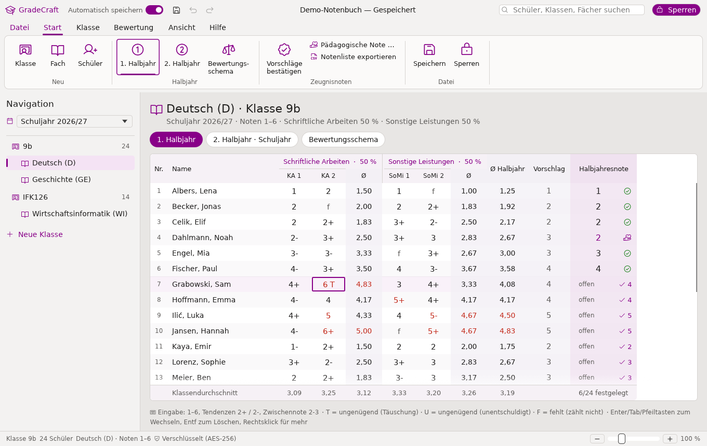

# GradeCraft

Notenverwaltung für Lehrkräfte – lokal, verschlüsselt, in reinem Rust (egui).
Die Bedienung orientiert sich an Microsoft Office: Ribbon-Menü, „Datei“-Backstage, Statusleiste. Akzentfarbe ist `#880088`.



## Funktionen

- **Klassen & Fächer**: Klassenbezeichnung (z. B. `9b`, `IFK126`), mehrere Fächer pro Klasse mit Name und Kürzel
- **Schüler**: Nachname, Vorname, Geschlecht (m / w / d / ohne Angabe). Einzeln anlegen oder als Liste importieren (CSV, aus Excel/SchILD kopiert)
- **Leistungsbereiche**: beliebig viele (z. B. „Schriftliche Arbeiten“, „Sonstige Leistungen“), jeweils mit eigener Gewichtung
- **Leistungen/Spalten**: frei benennbar (KA 1, Referat, Vokabeltest …), je Halbjahr beliebig viele, jeweils mit eigener Wertigkeit
- **Notenskalen**: Noten 1–6 mit Tendenzen (±⅓, z. B. `2+` = 1,67) und Zwischennoten (`2-3`) sowie Punkte 0–15. Weitere Skalen lassen sich ergänzen
- **Besondere Einträge**:
  - `T` = ungenügend wegen Täuschung
  - `U` = ungenügend wegen unentschuldigter Nichtteilnahme
  - `F` = fehlt, zählt nicht zum Schnitt
  - eine reguläre 6 bzw. 0 P = ungenügend wegen schlechter Leistung
- **Notenvorschläge**: Ø je Leistungsbereich (arithmetisches Mittel), daraus ein gewichteter Halbjahres- und Schuljahresvorschlag (kaufmännisch gerundet)
- **Zeugnisnoten**: Vorschlag mit einem Klick bestätigen oder pädagogisch festlegen (mit Begründung). GradeCraft warnt, wenn sich der Vorschlag nach dem Bestätigen noch ändert
- **Schuljahresnote**: wählbar
  - aus Halbjahresnote und 2. Halbjahr gewichtet (z. B. 1:1)
  - oder aus allen Einzelnoten des Jahres
- **Vorlagen** für Bewertungsschemata, **Schuljahreswechsel** mit Übernahme der Klassen (9b → 10b) und **Archiv** (schreibgeschützt)
- **Export** als CSV (Excel-kompatibel)
- **Rückgängig/Wiederholen**, automatisches Speichern, Suche, Zoom, Hell-/Dunkelmodus
- **Automatische Updates** über GitHub Releases (abschaltbar)

## Datenschutz

- Alle Daten liegen in **einer verschlüsselten Datei** (`.gcdb`): AES-256-GCM, Schlüssel per Argon2id aus dem Passwort abgeleitet.
- Keine Cloud und keine Telemetrie. Einzige Netzwerkverbindung ist die abschaltbare Update-Prüfung bei GitHub, ohne Datenübertragung.
- Automatische Sperre nach Inaktivität (Standard: 15 Minuten).
- Verschlüsselte Sicherungskopien (Standard: die letzten 10) im Unterordner `Sicherungen`.
- Speicherort frei wählbar:
  - Dokumente-Ordner
  - beliebiger Ordner, z. B. ein USB-Stick
  - **portabler Modus**: Liegt eine leere Datei `portable` neben `GradeCraft.exe`, werden Einstellungen und Daten im Programmordner gespeichert.
- ⚠️ Das Passwort ist nicht wiederherstellbar.

## Installation (Windows)

Unter [Releases](https://github.com/jordinchen/gradecraft/releases) liegen zwei Varianten:

- `GradeCraft-x.y.z-setup.exe`: Installer. Funktioniert ohne Administratorrechte, mit Startmenü-Eintrag und Dateizuordnung für `.gcdb`.
- `GradeCraft-x.y.z-portable.exe`: läuft ohne Installation.

Beim Start sucht GradeCraft nach neuen Versionen und kann sich per Klick aktualisieren.

## Entwicklung

```bash
cargo run -p gradecraft          # App starten
cargo test --workspace           # Tests (Rechenkern, Verschlüsselung, UI-Eingabe)
```

Projektaufbau:

| Pfad | Inhalt |
|---|---|
| `crates/gradecraft-core` | Datenmodell, Notenberechnung, Notenskalen, Verschlüsselung, CSV |
| `crates/gradecraft` | Oberfläche (eframe/egui): Ribbon, Navigation, Notentabelle, Dialoge, Updater |
| `installer/gradecraft.iss` | Inno-Setup-Skript für den Windows-Installer |
| `.github/workflows` | CI (Tests unter Linux/Windows) und Release-Build |

Debug-Builds lassen sich zum Ausprobieren mit Beispieldaten starten:

```bash
GRADECRAFT_DEV="view=course;theme=dark" cargo run -p gradecraft
```

### Release erstellen

1. Version in `Cargo.toml` (`[workspace.package]`) erhöhen.
2. Tag pushen:

   ```bash
   git tag v0.1.0 && git push origin v0.1.0
   ```

3. GitHub Actions baut Installer und portable `.exe` und veröffentlicht beide als Release. Installierte Versionen finden das Update automatisch.
